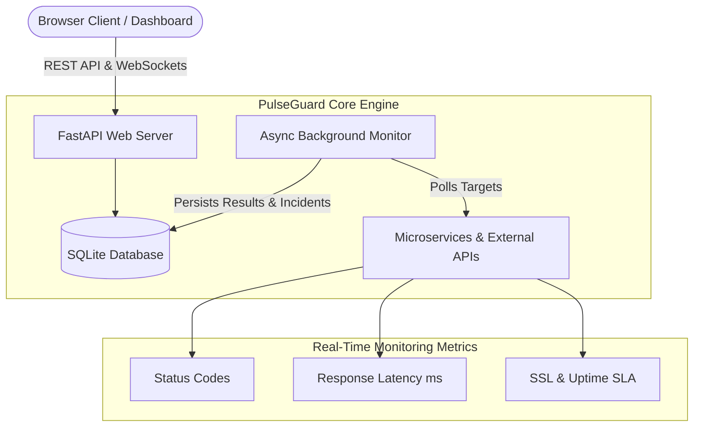

<div align="center">

# ⚡ PulseGuard

### Real-Time Service Health & API Monitoring Engine

[](https://fastapi.tiangolo.com)
[](https://python.org)
[](https://docker.com)
[](https://github.com/ttushaarr/pulseguard/actions)
[](LICENSE)

<p align="center">
  <b>PulseGuard</b> is a modern, lightweight, self-hosted service reliability engine designed to monitor HTTP/HTTPS APIs, microservices, and web endpoints with live telemetry, automated outage detection, and an interactive dark-mode dashboard.
</p>

[Quick Start](#-quick-start) •
[Features](#-key-features) •
[Architecture](#-architecture) •
[API Reference](#-api-endpoints) •
[Docker](#-docker-deployment)

</div>

---

## 🌟 Key Features

- **⚡ Async Non-Blocking Engine**: Concurrently monitors dozens of endpoints using Python's `asyncio` and `httpx`.
- **📊 Real-Time Interactive Dashboard**: Built with modern Tailwind CSS and Chart.js, featuring live latency line charts, uptime percentages, and automated 10-second polling.
- **🚨 Outage & Incident Management**: Automatically opens incidents when endpoints fail and resolves them when services recover.
- **📈 Historical Metrics**: Tracks response latency history, status codes, error logs, and computed uptime SLA.
- **🛠️ Instant Manual Checks**: Trigger on-demand health probes with a single click or API call.
- **🐳 Container Native**: Complete Docker and Docker Compose support for instant cloud deployment.
- **🧪 Production Ready**: Fully typed with Pydantic V2, clean SQLAlchemy 2.0 ORM models, and 100% automated test coverage.

---

## 🏗️ Architecture



---

## 🚀 Quick Start

### 1. Clone & Set Up Environment

```bash
git clone https://github.com/ttushaarr/pulseguard.git
cd pulseguard

# Create and activate virtual environment
python3 -m venv venv
source venv/bin/activate  # On Windows: venv\Scripts\activate

# Install dependencies
pip install -r requirements.txt
```

### 2. Run the Server

```bash
uvicorn app.main:app --reload --host 0.0.0.0 --port 8000
```

Open your browser at **`http://localhost:8000`** to access the live dashboard!  
Interactive Swagger API documentation is available at **`http://localhost:8000/docs`**.

---

## 🐳 Docker Deployment

Run PulseGuard instantly anywhere with Docker Compose:

```bash
docker compose up -d
```

PulseGuard will be up and running on port `8000` with data persisted in a Docker volume.

---

## 📡 API Endpoints

PulseGuard provides a clean RESTful interface:

| Method | Endpoint | Description |
| :--- | :--- | :--- |
| `GET` | `/` | Serves the interactive dark-mode dashboard |
| `GET` | `/api/stats` | Global system health stats (uptime %, avg response time, active outages) |
| `GET` | `/api/services` | List all monitored services with computed SLA & latest status |
| `POST` | `/api/services` | Register a new monitored service |
| `GET` | `/api/services/{id}` | Retrieve individual service details |
| `PATCH` | `/api/services/{id}` | Update service configuration (interval, url, expected status) |
| `DELETE` | `/api/services/{id}` | Remove service and cascade delete check history |
| `POST` | `/api/services/{id}/check`| Trigger an immediate on-demand health probe |
| `GET` | `/api/services/{id}/history`| Retrieve latency time-series data for charting |
| `GET` | `/api/incidents` | List outage incident timeline and resolution records |
| `GET` | `/health` | Self-health probe for container orchestrators |

---

## 🧪 Testing

PulseGuard includes an automated test suite verifying all API endpoints, database operations, and incident tracking:

```bash
pytest -v tests/
```

---

## 👤 Author

**Tushar Urkudkar**
- GitHub: [@ttushaarr](https://github.com/ttushaarr)

---

## 📄 License

This project is open-source and licensed under the [MIT License](LICENSE).
